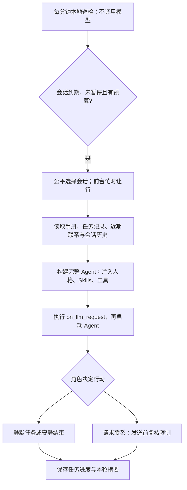

# 心跳助手（Heartbeat）

为会话里的角色提供周期性的后台活动机会。Agent 根据任务手册和近期状态，可以继续任务、整理信息、联系用户，也可以安静结束。

这是一个周期唤醒、逐轮衔接的决策循环。模型在两轮之间不会持续运行；每轮仍使用 AstrBot 的完整主 Agent、当前会话的人格、已启用的工具与 Skills。实际能力取决于会话配置和已安装插件。

## 兼容性与安装

- 版本：3.0.0；声明 AstrBot `>=4.25.1,<5`，已核验的框架版本为 **4.25.1**。后续框架版本仍需验证适配。
- Python 3.12+；Windows 使用 `tzdata` 时区数据，由 `requirements.txt` 声明。
- 默认登记进入正常 LLM 对话的私聊会话。群聊默认关闭，需要管理员在插件配置中明确开启。
- 从插件仓库安装或更新后，通过 WebUI 重载。首次使用时正常聊天一次，然后用 `/heartbeat_status` 查看状态。
- 本版本升级行为和数据迁移见 [CHANGELOG.md](CHANGELOG.md)。已有手册不会被覆盖。

仓库：[Neri-0721/astrbot_plugin_heartbeat](https://github.com/Neri-0721/astrbot_plugin_heartbeat)。市场是否可安装取决于实际收录状态；仓库中有发布信息不等于已经上架。

## 一轮后台活动如何执行



后台与正常聊天共用 AstrBot 的会话锁，避免两边覆盖历史。执行期间收到真实用户消息时，后台会请求协作停止，并阻止继续发送基于旧状态的联系。已经开始的工具操作可能需要返回后才能停止；每轮另有超时上限。

新版本直接在定时回调中构建并等待完整 Agent，不再排入一个插件无法等待完成的一次性 active job。调用顺序与普通聊天保持一致：构建 → 请求前钩子 → reset → Agent 开始/工具/结束事件。定时任务有独立来源标记，不会被本插件误记为用户聊天。

## 后台活动与主动联系分开控制

“近期聊过”“暂时别找我”“上次问候没有回应”限制主动联系。它们不会阻止 Agent 静默完成已有任务。

主动联系通过受控的 `send_message_to_user` 工具进行，支持原有文本、图片等消息组件，附加两个参数：

- `reason`：这次联系的具体理由。
- `topic`：稳定主题标识，例如 `lunch-reminder`、`followup-book-title`。同一件提醒应复用标识。

发送前重新检查当前时段、近期用户消息、显式免打扰、联系间隔、每天次数、未回应退避、当日主题与完全相同消息去重。每轮最多成功联系一次，只能联系绑定会话，成功发送后才记账。

默认第一次未回应后至少等待 24 小时，随后依次等待 48、96、192 小时；用户再次发消息时重置未回应次数。普通联系冷却仍生效。静默轮次不会增加未回应次数。普通提醒同样遵守这些限制，本版本没有“紧急”绕过入口。

这些规则是插件消息入口的运行控制，不是对整个宿主环境的隔离。具有独立网络发送能力的第三方工具应遵守心跳提示；插件不能拦截任意 Shell、HTTP 或 MCP 的外部副作用。

## 命令与控制

| 命令 | 作用 |
| --- | --- |
| `/heartbeat` | 帮助 |
| `/heartbeat_status` | 当前会话的后台状态、联系限制、实际规则来源和独立规则路径 |
| `/heartbeat_show` | 显示当前会话实际生效的手册 |
| `/heartbeat_test` | 立即尝试完整后台轮次；仅略过到期时间，仍遵守暂停、时段、预算和联系限制 |
| `/heartbeat_pause` | 暂停当前会话的后台活动 |
| `/heartbeat_resume` | 恢复当前会话，从配置间隔后运行 |
| `/heartbeat_quiet 120` | 120 分钟内不主动联系；后台仍可静默做事 |
| `/heartbeat_quiet 0` | 解除显式免打扰，其他联系限制仍有效 |
| `/heartbeat_unschedule` | 暂停全局调度，重启和普通聊天不会自动恢复；需要 AstrBot 管理员权限 |
| `/heartbeat_reschedule` | 重新读取全部配置、恢复全局调度并计算下一轮时间；需要管理员权限 |

聊天 Agent 还可以使用 `heartbeat_set_quiet` 工具，在用户明确要求时设置免打扰；需要当前人格允许该工具。后台轮次不能替用户修改这项设置。

群聊的暂停、恢复、免打扰和手动测试需要 AstrBot 管理员权限；普通成员仍可查看当前会话状态与规则。

## 配置

| 配置 | 默认值 | 含义 |
| --- | --- | --- |
| `interval_minutes` | `90` | 每会话两轮后台开始时间之间的最小间隔，支持 10—1440 分钟 |
| `startup_behavior` | `on_interaction` | 等待真实互动后启用调度；`auto` 在加载时恢复已存会话并启用调度 |
| `target_mode` | `all` | 公平轮转到期会话；`last` 只检查最后收到真实用户消息的会话 |
| `active_hours_start` / `active_hours_end` | `08:00` / `23:30` | 联系时段；支持跨午夜，相同时间表示全天 |
| `background_outside_active_hours` | `false` | 时段外是否仍可唤醒做静默任务；开启也不能在时段外主动联系 |
| `check_last_interaction` | `true` | 近期有真实用户消息时暂停主动联系 |
| `interaction_threshold_minutes` | `30` | 上述近期消息时间范围 |
| `max_daily_heartbeats` | `48` | 所有会话共享的每日 Agent 轮次上限 |
| `cooldown_seconds` | `120` | 全局两次后台开始之间的最小间隔 |
| `contact_cooldown_minutes` | `240` | 每会话主动联系的最小间隔 |
| `max_daily_messages` | `3` | 每会话每日成功主动联系上限 |
| `unanswered_backoff_hours` | `24` | 连续未回应的初始等待，逐次翻倍，最多八倍 |
| `agent_timeout_seconds` | `300` | 每轮包括准备阶段的超时上限 |
| `allow_group_sessions` | `false` | 允许进入 LLM 对话的群聊登记 |
| `timezone` | 空 | 继承 AstrBot 时区，再为空则使用系统时区；可填写 IANA 时区名称 |
| `heartbeat_content` | 空 | WebUI 中的全局默认手册；不覆盖磁盘文件 |
| `heartbeat_file_path` | 空 | 显式自定义手册路径，优先于其他来源 |

每分钟巡检不会调用模型。真正开始一轮时才保留额度并设置下次到期时间；执行超时或模型失败的已开始轮次也会计入。缺少模型、请求钩子主动停止或前台占用等准备阶段跳过不计入额度。实际开始还受轮转、时段、前台和预算影响，不提供精确时刻闹钟或补跑积压任务。

## 手册与连续状态

数据存储在 AstrBot 的 `data/plugin_data/astrbot_plugin_heartbeat/` 中：

```text
HEARTBEAT.md                  原有全局手册，保留
heartbeat.d/<平台实例ID>.md    兼容已有的平台定制手册
heartbeat.sessions/<SHA256>.md 真正独立的会话手册，可自行创建
state.json                    会话、预算、暂停、成功联系和任务进度
last_session.json             旧版恢复文件，迁移后保留原文件
```

规则优先级为：**显式自定义路径 → 会话手册 → 已定制的平台手册 → WebUI 全局内容 → 全局文件**。用 `/heartbeat_status` 获取当前会话文件路径，用 `/heartbeat_show` 确认实际来源。升级不会自动建立平台副本。

旧版自动生成且仍等于全局内容或旧内置模板的副本会按继承处理，原文件不删。已经编辑过的旧副本继续作为覆盖规则，并显示实际来源。如果希望它重新继承，可在确认后自行移走该平台文件。显式文件缺失或损坏会使该轮准备失败，不会偷偷改用另一套规则。

手册是交给 Agent 理解的自然语言，不是由 Python 执行的规则脚本。示例：

```markdown
保持当前会话配置的人格。每次醒来先看已有任务和上次行动结果。
- 如果还有未完成的阅读任务，可以继续整理；不要为了报告进度打扰用户。
- 如果有与最近话题相关的新信息，可以决定是否分享。
- 没有合适的事情时，安静结束。
- 午饭提醒每天最多一次，使用稳定主题 lunch-reminder。
- 不能联系时，照样可以静默处理已有任务。
```

Agent 可通过 `heartbeat_remember(key, text, status)` 保存少量任务进度，`status` 为 `pending`、`done` 或 `drop`。每会话最多 64 条，每条正文最多 1000 字符。任务笔记和本轮摘要明确标记为 Agent 自述，不能作为独立核实的完成证据。成功联系由实际发送入口记录。

## 验证与开发

```bash
python -m pip install -r requirements.txt ruff==0.15.12
ruff check .
ruff format --check .
python -m unittest discover -v
```

如已有完整 AstrBot 源码和配套 Python，可执行真实构建器/Runner 的离线验证：

```bash
python tools/verify_astrbot.py --source /path/to/AstrBot
```

该脚本使用离线 Provider 和临时数据目录，运行真实 Agent 和工具生命周期，验证静默任务、受控发送、人格和请求钩子衔接；不调用线上模型、不接入真实平台。模型是否会作出合适决定仍需单独进行真实对话验证。详细范围见 [docs/verification.md](docs/verification.md)。

发布遵循 [AstrBot 开发指南](https://docs.astrbot.app/dev/star/plugin-new.html)、[发布说明](https://docs.astrbot.app/dev/star/plugin-publish.html)和[市场身份规范](https://docs.astrbot.app/dev/plugin-market/2026-06-27.html)。保持作者/名称身份与市场记录一致；提交前通过 Ruff 两项检查；发布包小于 16 MB，不包含用户数据、日志、缓存或虚拟环境。

## 许可证与贡献者

[AGPL-3.0](LICENSE)。作者：Neri0721；原型贡献者：Key。
